<div align="center">



<a href="https://git.io/typing-svg">
  
</a>

<p>
  <a href="https://www.linkedin.com/in/zahrat-eloulaa-h-02a51b246"></a>
  <a href="mailto:zahrateloulaa.hamdani@gmail.com"></a>
  
</p>

<p>
  
  
  
  
  
</p>

</div>

---

## 👩‍💻 About me

I'm a **Data Science & AI Engineering** student at **TEK-UP University**, currently on an **exchange at CESI** (France). I design and deploy practical AI solutions: **machine-learning models, NLP applications and full-stack platforms** that process data in real time.

I learn by building. I like taking a vague, complex problem and turning it into software that is **clear, efficient and pleasant to use**, from the notebook all the way to a containerised API with a UI on top.

```python
class ZahratElOulaa:
    role      = "Data Science & AI Engineering student"
    school    = ["TEK-UP University (2022 - 2027)", "CESI exchange (Sept 2026)"]
    based_in  = "France 🇫🇷"
    languages = {"Arabic": "native", "French": "native", "English": "full professional", "German": "elementary"}
    strengths = ["RAG & LLM apps", "NLP (incl. Tunisian dialect)", "MLOps", "Full-stack AI platforms"]
    currently = "Exploring agentic workflows & LLM fine-tuning"
    seeking   = "6-month end-of-studies internship, starting February 2027"

    def say_hi(self):
        return "Let's build something intelligent. 🚀"
```

---

## 🧭 What I work with

<div align="center">
  
</div>

---

## 💼 Experience

| When | Where | What I did |
|:--|:--|:--|
| **Jul – Aug 2026** | **3LM Solutions** · Summer Intern · 🇹🇳 | Built an **AI SaaS language-learning platform** with **Python, FastAPI and speech-to-text models**: real-time transcription and automated scoring, improving speech-recognition accuracy. |
| **Jun – Aug 2025** | **Enda Tamweel** · Summer Intern · 🇹🇳 | Delivered an **end-to-end automation pipeline** combining a custom **AI chatbot with RPA**. Developed and fine-tuned an **NLP model for the Tunisian dialect (Derja)**. |

---

## 🚀 Featured projects

<table>
<tr>
<td width="50%" valign="top">

### 🏭 [Industrial Defect Detection (MLOps)](https://github.com/Zahrat-ElOula/MLOps---Detection-de-defauts-industriels-)
Two-stage vision system on **MVTec AD**: **ResNet18** classifies good/bad parts, **YOLOv8** localises the defect. Full MLOps chain: **DVC** for data, **MLflow** for experiments, **ONNX** export, **FastAPI** + **React** UI, **Docker**, **GitHub Actions** CI/CT, and a *"report an error"* feedback loop that triggers retraining.

`PyTorch` `YOLOv8` `MLflow` `DVC` `FastAPI` `React` `Docker`

</td>
<td width="50%" valign="top">

### 📚 [Mini RAG with Groq & Ollama](https://github.com/Zahrat-ElOula/mini-RAG-with-GROQ-and-ollama)
Ask questions about your own PDFs. Documents are chunked, embedded and indexed in **FAISS**; answers come from **Groq** (speed) or a **local Ollama model** (privacy), always with **source and page citations**.

`LangChain` `FAISS` `HuggingFace` `Groq` `Ollama`

</td>
</tr>
<tr>
<td width="50%" valign="top">

### 🏠 [Smart Home Big Data Analysis](https://github.com/Zahrat-ElOula/Smart_Home_Big_Data_Analysis)
End-to-end **PySpark** pipeline on **247M sensor measurements** (24 sensors, ~6 months): EDA, cleaning, 5-minute windowing, KMeans clustering, feature reduction (**175 → 47 variables**), then a **Kafka** streaming replay with live inference.

`PySpark` `Kafka` `KMeans` `Docker` `Parquet`

</td>
<td width="50%" valign="top">

### 💼 [AI-Powered CRM](https://github.com/Zahrat-ElOula/CRM_Client_Management_With_AI)
Full-stack CRM that uses **OpenAI GPT** to analyse each new client automatically: key insights, keyword extraction, **priority scoring** (high / medium / low) and smart summaries, with dashboard, search and a REST API.

`ASP.NET Core` `C#` `MongoDB` `OpenAI`

</td>
</tr>
<tr>
<td width="50%" valign="top">

### 🎨 [TalentForge](https://github.com/2ammyy/TalentForge) *(team project)*
AI-driven networking platform where **creative work is the résumé**. Transformer-based **content moderation**, creative-relevance scoring, creator analytics, real-time messaging via WebSockets.

`Django` `PostgreSQL` `Hugging Face` `Redis` `Celery` `Docker`

</td>
<td width="50%" valign="top">

### 🌦️ [WeatherGuardTN](https://github.com/2ammyy/WeatherGuardTN_AI_BI_project) *(team project, in progress)*
Early-warning predictor for dangerous weather in Tunisia: heat, floods, storms and school closures, with colour-coded vigilance levels per governorate and a React dashboard aimed at citizens and civil protection.

`FastAPI` `XGBoost` `React` `n8n`

</td>
</tr>
</table>

---

## 🛠️ Tech stack

<div align="center">

**🤖 AI & Data**<br>


**🌐 Backend & Web**<br>


**⚙️ MLOps, Big Data & Cloud**<br>


**📊 Business Intelligence**<br>


</div>

---

## 🌱 What I'm exploring next

| 🔬 Now | 🎯 Next |
|:--|:--|
| Retrieval pipelines with vector embeddings | Agentic frameworks & orchestration |
| Fine-tuning LLMs for domain-specific tasks | Evaluating RAG quality at scale |
| Forecasting & predictive modelling | Shipping AI features to real users |

<div align="center">

**💬 Ask me about:** Python · RAG · Groq / Ollama · NLP for low-resource dialects · MLOps · Time-series forecasting

</div>

---

## 📈 GitHub activity

<div align="center">

<picture>
  <source media="(prefers-color-scheme: dark)" srcset="https://raw.githubusercontent.com/Zahrat-ElOula/Zahrat-ElOula/output/github-contribution-grid-snake-dark.svg">
  <source media="(prefers-color-scheme: light)" srcset="https://raw.githubusercontent.com/Zahrat-ElOula/Zahrat-ElOula/output/github-contribution-grid-snake.svg">
  
</picture>

<br>


</div>

---

<div align="center">

### 🤝 Let's build something together

Hiring for a **PFE internship starting February 2027**, or just want to talk RAG, NLP or MLOps? I'd love to hear from you.

<a href="https://www.linkedin.com/in/zahrat-eloulaa-h-02a51b246"></a>
<a href="mailto:zahrateloulaa.hamdani@gmail.com"></a>

<sub>⭐ If one of my projects helped you, a star is always appreciated.</sub>

</div>
